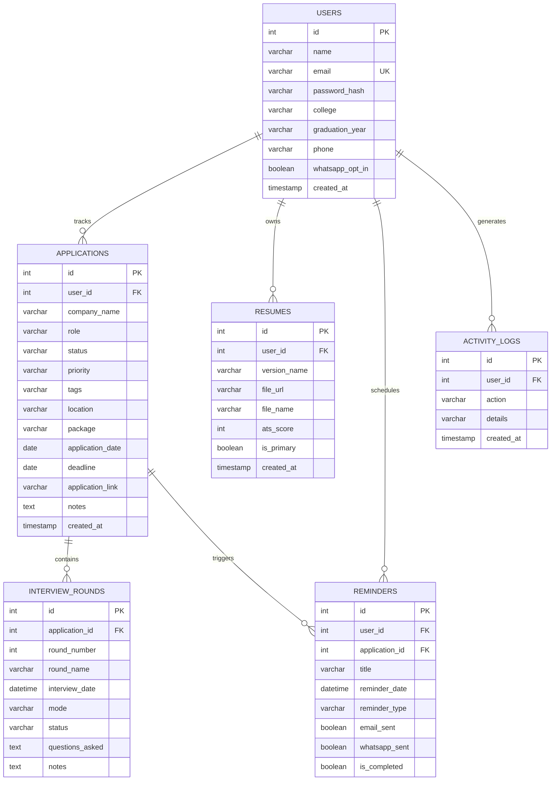

# HuntOS (v2.0) — Technical Architecture & Presentation Guide
> **The Autonomous Career & Placement Operating System**  
> Engineered and Architected from scratch by **Niranjan Krishnakumar**

---

## 📑 Table of Contents
1. [Project Inception & Core Vision](#1-project-inception--core-vision)
2. [Architectural Overview](#2-architectural-overview)
3. [Deep-Dive: Database Design & Schema](#3-deep-dive-database-design--schema)
4. [Deep-Dive: Google Gemini AI Copilot Engine](#4-deep-dive-google-gemini-ai-copilot-engine)
5. [Deep-Dive: FastClip Chrome Extension (Manifest V3)](#5-deep-dive-fastclip-chrome-extension-manifest-v3)
6. [Deep-Dive: Frontend State & UI Engineering](#6-deep-dive-frontend-state--ui-engineering)
7. [Deep-Dive: Background Workers & Automated Notifications](#7-deep-dive-background-workers--automated-notifications)
8. [Codebase Directory Walkthrough](#8-codebase-directory-walkthrough)
9. [Viva & Technical Interview Defense Guide](#9-viva--technical-interview-defense-guide)
10. [Key Technical Decisions & Tradeoffs](#10-key-technical-decisions--tradeoffs)

---

## 1. Project Inception & Core Vision

### The Problem Space
During recruitment seasons, applicants apply to dozens—sometimes hundreds—of engineering roles across multiple platforms (LinkedIn, Indeed, company portals, university placement cells). This causes severe operational friction:
- **Application Amnesia**: Forgetting what salary, job description, or requirements were posted once the listing expires.
- **Scattered Interview Timelines**: Inability to track round-by-round topics, questions asked, and interviewer feedback.
- **Unoptimized Resumes**: Submitting generic resumes that get immediately rejected by Applicant Tracking Systems (ATS).
- **Missed Deadlines**: Missing online assessments (OAs) or interview rounds due to inbox clutter.

### The Solution: HuntOS
HuntOS is an **end-to-end career intelligence and application tracking system** engineered by Niranjan Krishnakumar. It unites:
- A dual-mode pipeline (Kanban board + sortable table).
- An AI-powered DOM extraction browser extension (**FastClip**).
- A generative interview preparation copilot powered by **Google Gemini 2.5**.
- An algorithmic **ATS Resume Scorer & Google XYZ Bullet Rewriter**.
- An automated multi-channel alert system dispatching via **Email** and **WhatsApp**.

---

## 2. Architectural Overview

HuntOS follows a **decoupled client-server micro-architecture**:

```
[ Chrome Extension (FastClip) ] ────┐
                                    │ (REST / JSON)
                                    ▼
[ React 19 Frontend (Vite) ] ───► [ Express REST API (Node 20+) ]
                                    │
               ┌────────────────────┼────────────────────┐
               ▼                    ▼                    ▼
      [ MySQL 8.0 Cloud ]   [ Google Gemini AI ]  [ Cloudinary Vault ]
       (Aiven / InnoDB)     (2.5 Flash / Fallback)   (Encrypted PDFs)
               │                    │
               └──────────┬─────────┘
                          ▼
            [ node-cron Dispatcher ]
              ├── Twilio (WhatsApp)
              └── Nodemailer (SMTP)
```

### Architectural Principles
1. **Separation of Concerns**: Controllers handle HTTP validation, services encapsulate external APIs (Cloudinary, Twilio, Gemini), and models/schema enforce relational integrity.
2. **Resilience & Self-Healing**: Database connections feature automatic reconnection pools and non-destructive startup migrations (`runAutoMigrations`).
3. **Optimistic & Responsive UI**: Instant UI feedback on status transitions with background state synchronization.

---

## 3. Deep-Dive: Database Design & Schema

HuntOS utilizes a normalized **MySQL 8.0 relational schema** managed through `mysql2/promise`.

### Entity Relationship Diagram (ERD)



### Performance Optimization & Indexing
To support rapid queries during dashboard loads:
- `idx_user_status`: Compound index on `applications(user_id, status)` ensures sub-millisecond filtering across Kanban columns.
- `idx_user_priority`: Compound index on `applications(user_id, priority)` for instant priority sorting.
- `idx_user_app`: On `interview_rounds(application_id)` to hydrate interview timelines instantaneously.
- `ON DELETE CASCADE`: Foreign keys enforce referential integrity. Deleting an application automatically purges associated interview rounds and application-specific reminders.

---

## 4. Deep-Dive: Google Gemini AI Copilot Engine

Located at `server/controllers/aiController.js`, the AI engine communicates with the Google Generative AI platform.

### Multi-Model Fallback Architecture
Google Gemini frequently updates models. To ensure high availability, Niranjan Krishnakumar architected a **cascading fallback mechanism**:
1. **Primary Model**: `gemini-2.5-flash` (lowest latency, highest reasoning accuracy).
2. **Fallback Model**: `gemini-flash-latest` (ensures uptime if rate limits or deprecations occur).
3. **Payload Sanitizer**: Strips markdown formatting backticks (````json ... ````) before executing `JSON.parse()`.

### Key AI Endpoints

#### 1. FastClip DOM Entity Extractor (`POST /api/ai/extract`)
- Extracts raw DOM innerText (up to 5,000 characters) from job portals.
- Feeds this text to Gemini with a strict JSON schema prompt to extract:
  - `company_name` (clean string, e.g. "Google" instead of "Google Careers Inc.")
  - `role` (standardized title, e.g. "Senior Backend Engineer")
  - `location` (e.g. "Bengaluru, India" or "Remote")
  - `package` (e.g. "₹24 LPA" or "$140,000/yr")
  - `deadline` (ISO YYYY-MM-DD or null)
  - `tags` (suggested technology tags, e.g. "Go, Kubernetes, Distributed Systems")

#### 2. Role-Specific Interview Preparation Kit (`POST /api/ai/prep`)
- Considers the company name, role, CTC package, and current status.
- Generates a customized 4-part prep kit:
  1. **Core DSA & System Topics**: Exact data structures and distributed systems concepts frequent in that company's hiring loops.
  2. **Technical Interview Questions**: Real-world interview questions asked for this role.
  3. **STAR Method Behavioral Scenarios**: Behavioral questions with situational answering frameworks.
  4. **Insider Strategy Tips**: Strategic negotiation and communication advice tailored to the company's culture.

#### 3. ATS Resume Matcher & Google XYZ Rewriter (`POST /api/ai/ats-review`)
- Compares resume text against the target job description.
- Computes:
  - **ATS Match Score (0–100%)**: Quantitative score based on core technical competencies.
  - **Identified Keyword Gaps**: Missing hard and soft skills.
  - **Bullet Point Transformations**: Takes generic resume bullets and rewrites them into the **Google XYZ formula**:  
    *“Accomplished [X], as measured by [Y], by doing [Z]”*.

#### 4. Tailored Cover Letter Generator (`POST /api/ai/cover-letter`)
- Synthesizes user experience and company mission into an engaging, non-cliché cover letter.

---

## 5. Deep-Dive: FastClip Chrome Extension (Manifest V3)

The extension enables **1-click job clipping** directly from job boards.

### Communication Flow
```
User browses LinkedIn / Indeed
       │
Clicks "HuntOS FastClip"
       │
popup.js ──► content.js : { action: "getPageContent" }
                 │
            content.js reads document.body.innerText (sanitized 5000 chars)
                 │
popup.js ◄───────┘
       │
popup.js ──► background.js : { action: "extractViaBackend", content, url }
                 │
            background.js executes authenticated POST /api/ai/extract
                 │
popup.js ◄───────┘
       │
User reviews pre-filled form with Priority & Tags ──► Clicks "Save to HuntOS"
       │
background.js executes POST /api/applications ──► Application saved!
```

### Seamless Auth Sync Bridge
Users do not need to re-login into the extension. The web application dispatches a window message upon login:
```javascript
window.postMessage({ type: 'HUNTOS_LOGIN', token, user }, '*');
```
The content script (`content.js`) listens for this event and securely caches credentials in `chrome.storage.local`.

---

## 6. Deep-Dive: Frontend State & UI Engineering

### Tech Stack & Choices
- **React 19**: Modern concurrent features and hooks.
- **Vite 6**: Instant hot module replacement (HMR) and optimized rollup production bundles.
- **Tailwind CSS v4**: Theme defined using CSS variables (`@theme { ... }`) for performance and maintainability.
- **Lucide React**: Clean, modern iconography.

### Key Components Built by Niranjan
- `KanbanBoard.jsx`: Drag/click interactive placement pipeline with stage counts and quick action buttons.
- `AIInterviewCopilot.jsx`: Modal with tabbed prep kits, dynamic copy actions, and Gemini-generated questions.
- `ATSResumeMatcher.jsx`: Real-time resume evaluation modal with visual percentage gauges and Google XYZ suggestions.
- `OfferComparator.jsx`: Financial modeling calculator comparing Base, Bonus, Stock/ESOPs, and Cost of Living.
- `StatusBadge.jsx`: Dynamic status pill with pulsating indicator dots.

---

## 7. Deep-Dive: Background Workers & Automated Notifications

Located at `server/jobs/reminderJob.js`:
- Powered by `node-cron` running on an hourly schedule (`0 * * * *`).
- Queries all pending reminders where `reminder_date <= NOW()` and `is_completed = 0`.
- **Nodemailer Service**: Generates dark-themed HTML emails with direct links back to the user's HuntOS application record.
- **Twilio WhatsApp Service**: Sends formatted WhatsApp push notifications directly to the student's mobile device.

---

## 8. Codebase Directory Walkthrough

```
HuntOS-v2.0/
├── client/                              # React 19 Frontend
│   ├── public/
│   │   └── favicon.svg                  # Custom HuntOS vector emblem
│   ├── src/
│   │   ├── components/
│   │   │   ├── AIInterviewCopilot.jsx   # Gemini prep kit modal
│   │   │   ├── ATSResumeMatcher.jsx     # ATS resume analysis modal
│   │   │   ├── KanbanBoard.jsx          # Pipeline Kanban view
│   │   │   ├── OfferComparator.jsx      # Financial comparison calculator
│   │   │   ├── Logo.jsx                 # Dynamic geometric SVG logo
│   │   │   ├── Sidebar.jsx              # Navigation with active indicators
│   │   │   └── StatusBadge.jsx          # Stage indicators
│   │   ├── pages/
│   │   │   ├── Landing.jsx              # High-conversion landing page
│   │   │   ├── Dashboard.jsx            # KPIs, quick actions, export buttons
│   │   │   ├── Applications.jsx         # Dual Kanban / Table view
│   │   │   ├── ApplicationDetail.jsx    # Interview timeline manager
│   │   │   ├── ResumeManager.jsx        # Resume uploads & ATS scoring
│   │   │   ├── Analytics.jsx            # Funnel charts & Offer Comparator
│   │   │   └── Settings.jsx             # Profile & CSV export
│   │   ├── api.js                       # Axios instance with interceptors
│   │   ├── index.css                    # Tailwind v4 theme definitions
│   │   └── App.jsx                      # Route configurations
│   └── package.json
│
├── server/                              # Node.js Express REST Backend
│   ├── config/
│   │   └── db.js                        # Resilient MySQL connection & auto-migrator
│   ├── controllers/
│   │   ├── aiController.js              # Gemini 2.5 AI integration
│   │   ├── applicationController.js     # Applications CRUD & CSV export
│   │   ├── authController.js            # JWT auth & bcrypt security
│   │   ├── interviewController.js       # Timeline rounds management
│   │   └── resumeController.js          # Cloudinary upload & ATS updates
│   ├── routes/                          # Express route definitions
│   ├── services/
│   │   ├── emailService.js              # HTML email dispatcher
│   │   └── whatsappService.js           # Twilio WhatsApp sender
│   ├── jobs/
│   │   └── reminderJob.js               # node-cron scheduler
│   ├── schema.sql                       # Database schema with indexes
│   ├── seed.js                          # Demo data for Niranjan Krishnakumar
│   └── index.js                         # Server entry point
│
├── extension/                           # HuntOS FastClip Chrome Extension
│   ├── manifest.json                    # Chrome Manifest V3
│   ├── content.js                       # DOM scraper & auth listener
│   ├── background.js                    # Service worker
│   ├── popup.html                       # FastClip popup UI
│   ├── popup.js                         # Popup logic
│   └── styles.css                       # Obsidian-indigo styling
│
├── docker-compose.yml                   # Multi-container orchestration
└── README.md                            # Public repository documentation
```

---

## 9. Viva & Technical Interview Defense Guide

When presenting HuntOS in a viva, technical interview, or project review, use these battle-tested answers:

### Q1: "Walk us through how you built HuntOS from scratch."
> **Answer**:  
> *"I designed HuntOS to solve the high-stress, fragmented nature of student placements. I architected it in three tiers:  
> 1. A **React 19 single-page application** styled with Tailwind CSS v4, supporting both Kanban and high-density tabular pipelines.  
> 2. A **Node.js Express REST API** structured around the controller-service pattern, featuring a resilient MySQL pool with dynamic startup auto-migrations.  
> 3. An **AI & Extension ecosystem** comprising the FastClip Chrome Extension (Manifest V3) for 1-click DOM parsing and Google Gemini 2.5 Flash for role-specific interview preparation kits and ATS resume scoring.  
> The entire stack is containerized with Docker and features automated cron jobs for WhatsApp and email alerts."*

---

### Q2: "Why did you choose MySQL over MongoDB for this project?"
> **Answer**:  
> *"The career tracking domain is inherently relational. An Application belongs to a User, contains multiple sequential Interview Rounds, has associated Reminders, and links to Resume versions.  
> With MySQL:  
> 1. We enforce strict data consistency using Foreign Keys and `ON DELETE CASCADE`. If a user deletes an application, all orphaned interview notes and reminders are automatically purged.  
> 2. We can perform complex analytic queries (e.g. conversion rates across interview stages) using SQL joins and aggregations far more reliably than multi-document lookups in NoSQL.  
> 3. We implemented compound B-tree indexes on `(user_id, status)` and `(user_id, priority)` to keep pipeline queries under 5ms even with thousands of records."*

---

### Q3: "How does the FastClip Chrome Extension work without breaking across different job boards?"
> **Answer**:  
> *"Traditional scrapers rely on hardcoded CSS selectors (e.g., `div.job-title`), which break the moment LinkedIn or Indeed changes their layout.  
> Instead of brittle selectors, I architected a **generative extraction pipeline**:  
> 1. The extension's content script safely extracts the sanitized text content from the DOM.  
> 2. It relays this payload to our backend `POST /api/ai/extract` endpoint.  
> 3. We pass this text to **Google Gemini 2.5 Flash** with a strict JSON schema prompt instructing it to identify company, role, package, location, and deadline from natural language.  
> This means FastClip works across any website—LinkedIn, Indeed, AngelList, or even a college placement notice board."*

---

### Q4: "How does the ATS Resume Matcher evaluate resumes?"
> **Answer**:  
> *"The ATS Matcher compares candidate resumes against job descriptions through two mechanisms:  
> 1. **Semantic & Keyword Analysis**: The Gemini engine checks for hard skills, framework proficiencies, and domain keywords present in the JD but absent from the resume.  
> 2. **Quantification & Impact Scoring (Google XYZ Formula)**: Recruiters look for measurable outcomes. Our AI identifies passive bullet points (e.g., 'Worked on backend APIs') and rewrites them into the Google XYZ format: 'Achieved [X], measured by [Y], by doing [Z]' (e.g., 'Reduced API latency by 42% by migrating from REST to Redis-cached GraphQL endpoints')."*

---

### Q5: "How did you ensure security and fault tolerance?"
> **Answer**:  
> *"Several measures were engineered:  
> - **Authentication**: Passwords are salted and hashed using bcrypt (10 rounds). All protected routes pass through a JWT verification middleware.  
> - **CORS Protection**: Dynamic origin whitelist preventing unauthorized cross-origin requests while allowing local development and production domains.  
> - **Self-Healing Database Pool**: `db.js` wraps MySQL connection attempts with graceful degradation. On startup, `runAutoMigrations()` checks `information_schema` and dynamically runs `ALTER TABLE` to ensure all columns and indexes exist without ever dropping user data.  
> - **Secure File Storage**: Resumes are uploaded through Multer memory streams directly to Cloudinary with authenticated URL signatures."*

---

## 10. Key Technical Decisions & Tradeoffs

| Decision | Alternative Considered | Rationale |
|---|---|---|
| **Google Gemini 2.5 Flash** | OpenAI GPT-4o | Gemini Flash offers near-zero latency, exceptional JSON mode reliability, and a generous free-tier ideal for student developer deployments. |
| **Tailwind CSS v4 (@theme)** | Material UI / Chakra UI | Tailwind v4 provides a zero-runtime CSS bundle and complete design autonomy, allowing us to build the dark Linear-inspired aesthetic. |
| **node-cron in same process** | Separate microservice / Celery | Running node-cron inside the Node.js Express runtime keeps deployment simple and reduces infrastructure costs for student budgets while handling hourly notification batches effortlessly. |
| **Chrome Manifest V3** | Manifest V2 | Manifest V3 is the modern Chrome standard utilizing lightweight service workers instead of persistent background pages, improving memory consumption and battery life. |

---

*Authored by Niranjan Krishnakumar — HuntOS Platform Architect*
