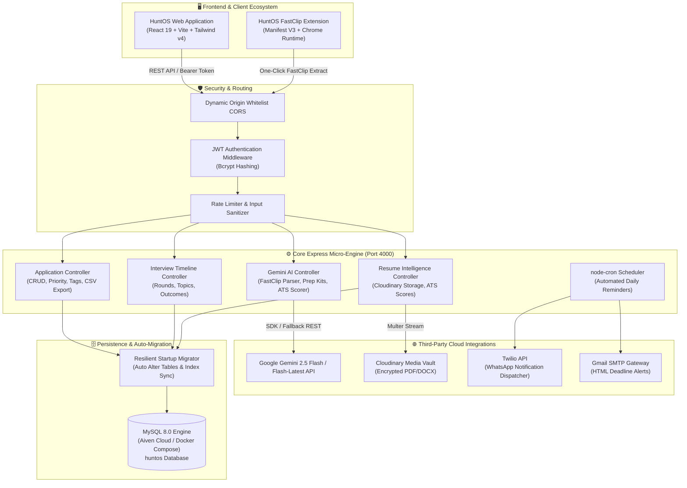

# HuntOS (v2.0) ⚡
> **The Autonomous Career & Placement Operating System**  
> Engineered & Architected from scratch by **Niranjan Krishnakumar**

[](https://react.dev/)
[](https://vitejs.dev/)
[](https://tailwindcss.com/)
[](https://nodejs.org/)
[](https://expressjs.com/)
[](https://www.mysql.com/)
[](https://ai.google.dev/)
[](https://www.docker.com/)
[](https://opensource.org/licenses/MIT)

---

## 🧭 Executive Overview

**HuntOS** is an enterprise-grade placement management and career hunting platform engineered from the ground up to replace fragmented spreadsheets, disorganized notes, and disconnected job search tools.

Built with an ultra-responsive dark-mode-first aesthetic inspired by Linear and Raycast, HuntOS couples a **dual-view application engine** (Kanban Board + High-Density Table) with a **deep Google Gemini AI Copilot** suite, an intelligent **FastClip Chrome Extension**, real-time **ATS resume scoring**, and automated multi-channel deadline alerts (Email + WhatsApp).

---

## 🏗 System Architecture



---

## ✨ Key Differentiators & Advanced Features

### 1. 🗂 Dual-Pipeline Application Engine
- **Interactive Kanban Board**: Move opportunities across 6 placement stages (`Applied`, `Shortlisted`, `Technical Interview`, `HR Round`, `Offer Received`, `Rejected`).
- **High-Density Table View**: Sortable columns with real-time text search, status filters, priority filtering (`Urgent`, `High`, `Medium`, `Low`), and tag badges.
- **One-Click Data Portability**: Export your full pipeline into clean RFC-4180 compliant CSV or formatted JSON.

### 2. ⚡ FastClip Chrome Extension (Manifest V3)
- Instant background DOM scraper for job portals (LinkedIn, Indeed, Glassdoor, Wellfound, Unstop, etc.).
- Automatically communicates with the backend Gemini extraction pipeline to extract company name, exact job title, salary package, location, and application deadline with zero manual entry.
- Direct synchronization with the HuntOS active session via custom message protocol.

### 3. 🧠 Google Gemini AI Interview Copilot
- **Personalized Prep Kits**: Generates company-specific technical interview questions, DSA focus patterns, behavioral STAR scenarios, and system design pointers tailored to the specific role and package.
- **Resilient Fallback Architecture**: Seamlessly falls back between `gemini-2.5-flash` and `gemini-flash-latest` with structured JSON parsing safeguards.

### 4. 🎯 ATS Resume Matcher & Google XYZ Rewriter
- Upload resumes securely to Cloudinary with metadata parsing.
- Evaluate resumes against exact job descriptions to calculate an algorithmic **ATS Match Score (0–100%)**.
- Provides keyword gap analysis (missing tech stack keywords) and rewrites bullet points into high-impact **Google XYZ formula** statements (*"Accomplished [X] as measured by [Y] by doing [Z]"*).

### 5. 💰 Multi-Offer Financial Comparator
- Built-in compensation modeling engine embedded in the Analytics dashboard.
- Compare multiple employment offers side-by-side: Base Salary, Annual Performance Bonus, Equity Vesting, and Relocation Allowances.

### 6. ⏰ Omni-Channel Deadline Watchdog
- Background `node-cron` daemon continuously scans for pending submission deadlines and upcoming interview rounds.
- Dispatches styled HTML email reminders (Nodemailer) and real-time WhatsApp push notifications (Twilio).

### 7. 🛡️ Resilient Database & Auto-Migration Layer
- Self-healing MySQL connection pool.
- Automatically inspects the database schema on boot and executes non-destructive schema migrations (e.g., adding `priority`, `tags`, `ats_score`, and compound indexes) without data loss.

---

## 🛠 Tech Stack

| Domain | Technology | Details |
|---|---|---|
| **Frontend Framework** | React 19 + Vite 6 | Lightning-fast HMR and modular component tree |
| **Styling & Design** | Tailwind CSS v4 + Lucide Icons | Obsidian slate dark theme, electric indigo `#4F46E5` |
| **State & Forms** | React Context API + React Hook Form | Zero-prop-drilling auth context, validation schemas |
| **Data Visualization** | Recharts | Funnel charts, monthly trends, status breakdowns |
| **Backend Runtime** | Node.js (v20+) + Express.js | High-throughput REST API architecture |
| **Database** | MySQL 8.0 (`mysql2/promise`) | Relational schema with foreign keys and cascade rules |
| **AI Intelligence** | Google Gemini Generative AI SDK | `gemini-2.5-flash` with dynamic schema extraction |
| **Cloud Storage** | Cloudinary + Multer | Secure document vault for PDF/DOCX resumes |
| **Notification Engine** | Nodemailer (Gmail) + Twilio WhatsApp | Multi-channel automated alerts |
| **Automation** | Node-Cron | Scheduled cron jobs for deadline triggers |
| **Browser Extension** | Chrome Manifest V3 | DOM content extraction & session sync |
| **Containerization** | Docker + Docker Compose | Multi-container setup for client and server |

---

## 🚀 Quick Start Guide

### Prerequisites
- **Node.js** v20.0 or higher
- **MySQL** 8.0+ (local instance or cloud like [Aiven](https://aiven.io/))
- **Google Gemini API Key** ([Google AI Studio](https://aistudio.google.com/))

---

### Step 1: Clone the Repository
```bash
git clone https://github.com/yourusername/huntos.git
cd huntos
```

---

### Step 2: Configure Environment Variables

**Backend Configuration (`server/.env`):**
```bash
cp server/.env.example server/.env
```
Fill in the parameters:
```env
PORT=4000
NODE_ENV=development
CLIENT_URL=http://localhost:5173

# Database (MySQL)
DB_HOST=localhost
DB_USER=root
DB_PASSWORD=your_mysql_password
DB_NAME=huntos
DB_PORT=3306

# Authentication
JWT_SECRET=super_secret_huntos_jwt_key_2026_xyz
JWT_EXPIRES_IN=7d

# Google Gemini AI
GEMINI_API_KEY=your_gemini_api_key

# Cloudinary (Resume Storage - Optional for local dev)
CLOUDINARY_CLOUD_NAME=your_cloudinary_name
CLOUDINARY_API_KEY=your_cloudinary_key
CLOUDINARY_API_SECRET=your_cloudinary_secret

# Notifications (Optional)
EMAIL_USER=your_email@gmail.com
EMAIL_PASS=your_gmail_app_password
TWILIO_ACCOUNT_SID=your_twilio_sid
TWILIO_AUTH_TOKEN=your_twilio_token
TWILIO_WHATSAPP_FROM=whatsapp:+14155238886
```

**Frontend Configuration (`client/.env`):**
```bash
cp client/.env.example client/.env
```
```env
VITE_API_URL=http://localhost:4000
```

---

### Step 3: Initialize Database & Seed Demo Data
```bash
# Run schema
mysql -u root -p < schema.sql

# Seed platform with demo user (Niranjan Krishnakumar) & applications
cd server
npm install
node seed.js
```

---

### Step 4: Launch the Platform

Open two terminal windows:

**Terminal 1 — Backend API Server:**
```bash
cd server
npm run dev
# Server running at http://localhost:4000
```

**Terminal 2 — Frontend Client:**
```bash
cd client
npm run dev
# Frontend accessible at http://localhost:5173
```

---

### Step 5: FastClip Chrome Extension Setup (Optional)
1. Open Google Chrome and navigate to `chrome://extensions/`.
2. Toggle on **Developer mode** (top-right corner).
3. Click **Load unpacked** and select the `/extension` directory from this repository.
4. FastClip is now active in your browser toolbar!

---

## 🧪 Demo Credentials

For instant access and grading demonstrations without registration:
- **Email:** `niranjan@huntos.dev`
- **Password:** `hunt123`

*(Preloaded with applications at Google, Stripe, Microsoft, Atlassian, Uber, Databricks, complete with interview timelines and ATS scores).*

---

## 🐳 Docker Deployment

To launch the complete HuntOS ecosystem with a single command:
```bash
docker compose up --build
```
- **HuntOS Web Client:** `http://localhost:5173`
- **HuntOS REST API:** `http://localhost:4000`

---

## 📡 REST API Specification

### Authentication (`/api/auth`)
| Method | Route | Description | Auth Required |
|---|---|---|:---:|
| `POST` | `/api/auth/register` | Register new user profile | ❌ |
| `POST` | `/api/auth/login` | Authenticate and obtain JWT | ❌ |
| `GET` | `/api/auth/me` | Fetch active user credentials | ✅ |
| `PATCH` | `/api/auth/profile` | Update profile settings | ✅ |
| `PATCH` | `/api/auth/change-password` | Update account password | ✅ |
| `DELETE` | `/api/auth/account` | Permanently delete account and all cascade data | ✅ |

### Applications (`/api/applications`)
| Method | Route | Description | Auth Required |
|---|---|---|:---:|
| `GET` | `/api/applications` | Query applications (search, sort, filter) | ✅ |
| `POST` | `/api/applications` | Create application record | ✅ |
| `GET` | `/api/applications/stats` | Pipeline stage analytics & conversions | ✅ |
| `GET` | `/api/applications/export` | Stream pipeline as CSV or JSON format | ✅ |
| `GET` | `/api/applications/:id` | Fetch application with interview timeline | ✅ |
| `PATCH` | `/api/applications/:id` | Update status, priority, package, or tags | ✅ |
| `DELETE` | `/api/applications/:id` | Delete application | ✅ |

### Gemini AI Engine (`/api/ai`)
| Method | Route | Description | Auth Required |
|---|---|---|:---:|
| `POST` | `/api/ai/extract` | FastClip AI DOM parser & entity extractor | ✅ |
| `POST` | `/api/ai/prep` | Generate role-specific interview preparation kit | ✅ |
| `POST` | `/api/ai/ats-review` | Calculate ATS score, keyword gaps, bullet rewrites | ✅ |
| `POST` | `/api/ai/cover-letter` | Generate tailored cover letter | ✅ |

### Interviews & Timeline (`/api/interviews`)
| Method | Route | Description | Auth Required |
|---|---|---|:---:|
| `GET` | `/api/interviews/:appId` | List interview rounds for an application | ✅ |
| `POST` | `/api/interviews/:appId` | Log new interview round | ✅ |
| `PATCH` | `/api/interviews/round/:id` | Update round questions, topics, or outcome | ✅ |

### Resumes & Documents (`/api/resumes`)
| Method | Route | Description | Auth Required |
|---|---|---|:---:|
| `GET` | `/api/resumes` | List uploaded resume versions | ✅ |
| `POST` | `/api/resumes` | Upload resume to Cloudinary | ✅ |
| `PATCH` | `/api/resumes/:id/ats` | Update cached ATS score for resume | ✅ |
| `DELETE` | `/api/resumes/:id` | Delete resume record | ✅ |

### Reminders (`/api/reminders`)
| Method | Route | Description | Auth Required |
|---|---|---|:---:|
| `GET` | `/api/reminders` | Query upcoming deadline reminders | ✅ |
| `POST` | `/api/reminders` | Create custom reminder with notification channels | ✅ |
| `DELETE` | `/api/reminders/:id` | Dismiss reminder | ✅ |

---

## 👨‍💻 Engineering & Authorship

**HuntOS** was designed, engineered, and documented by:
- **Architect & Full Stack Engineer:** Niranjan Krishnakumar
- **Version:** 2.0.0
- **License:** MIT License

*Designed for students and developers worldwide to accelerate their career trajectories.*
